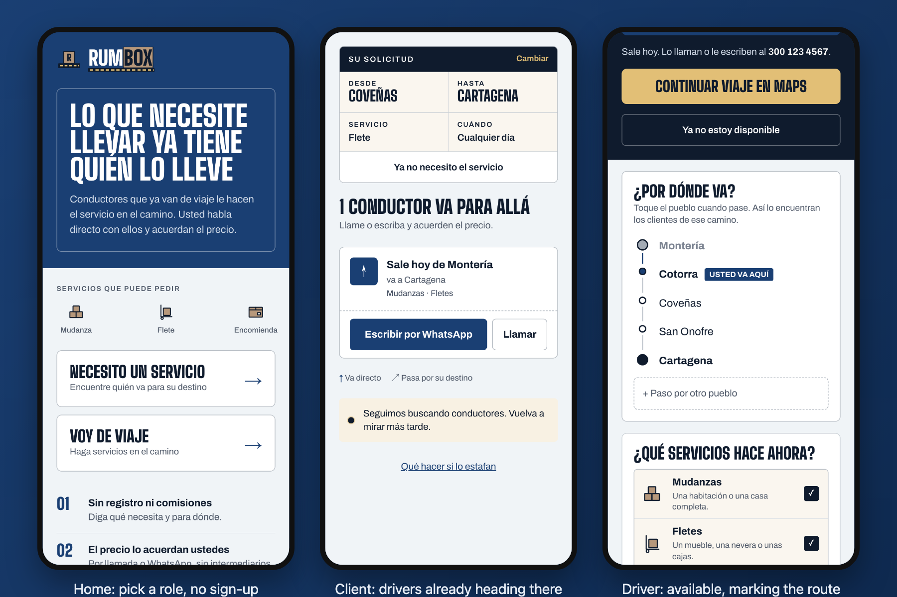

# Rumbox

[](https://github.com/ycantill/rumbox/actions/workflows/ci.yml)
[](https://muvia-ten.vercel.app)


> **English:** a PWA that connects people who need a move, a freight run or a
> parcel delivery in Colombia with drivers who are already on the road. No
> sign-up, no fees, direct contact by call or WhatsApp. See the
> [technical overview](#technical-overview) below.



Plataforma web (PWA) que conecta a quien necesita una mudanza, un flete o una
encomienda con conductores de furgones y camiones de estacas que ya van de
viaje hacia otro lado. Sin registro, sin comisiones y con contacto directo por
llamada o WhatsApp, en Colombia. Todavía no está definido dónde será el
piloto.

- **Cliente** (`/solicitar`): dice qué servicio necesita, de dónde a dónde y
  qué día (o "Cualquier día"). No da su teléfono. Ve los conductores que le
  sirven, los llama o les escribe por WhatsApp y acuerdan el precio. Si no
  hay nadie, su solicitud queda guardada y la lista se actualiza sola.
- **Conductor** (`/transportista`, "Voy de viaje"): se pone disponible para
  un viaje (de dónde sale, hacia dónde va o "Cualquier destino", desde qué
  día y qué servicios hace) y deja su teléfono. Sigue disponible hasta que
  toque "Ya no estoy disponible". Durante el viaje marca por dónde va y
  cambia los servicios que hace (si se llena, quita mudanzas y fletes).

El alcance del MVP y lo que queda para después está en
[docs/MVP.md](docs/MVP.md). La visión de negocio (modelo, monetización y
roadmap) es privada y no está en este repositorio. Las decisiones de producto y las convenciones del
código están en [CLAUDE.md](CLAUDE.md).

## Stack

- **Next.js 16** (App Router, TypeScript) con Server Actions
- **Tailwind CSS 4**
- **Supabase** (PostgreSQL)
- **Vercel** para el hosting

## Correr en local

Necesitas **Node.js 20 o superior** (el CI usa Node 22) y una cuenta gratuita
en [Supabase](https://supabase.com).

1. Instala las dependencias:

   ```bash
   npm install
   ```

2. Crea un proyecto en Supabase y activa la extensión **pg_cron**
   (Database → Extensions). En el **SQL Editor**, ejecuta en orden los
   archivos de `supabase/migrations/`, desde `0001_init.sql` hasta la última
   (hoy `0023_solo_carga.sql`). Cada vez que aparezca una migración nueva hay
   que ejecutarla también.

3. Copia `.env.example` a `.env.local`:

   ```bash
   cp .env.example .env.local
   ```

   y llena estas dos variables con los datos de **Project Settings → API** en
   Supabase:

   ```
   SUPABASE_URL=https://<tu-proyecto>.supabase.co
   SUPABASE_SERVICE_ROLE_KEY=<tu service role key>
   ```

   La service role key es secreta: solo se usa en el servidor, nunca lleva el
   prefijo `NEXT_PUBLIC_` y `.env.local` no se sube al repositorio.

   Para que la lista del cliente se actualice sola, llena también la variable
   de Realtime que explica `.env.example`. Sin ella la app funciona igual y la
   lista se pone al día cada minuto.

4. Arranca el servidor de desarrollo:

   ```bash
   npm run dev
   ```

   y abre http://localhost:3000.

   **Sin cuenta en Supabase:** con Docker puedes usar un Supabase local con
   todas las migraciones: `npm run db:start`, y en `.env.local` pon la URL y la
   service role key que muestra `npx supabase status`. Es el mismo que usan las
   pruebas E2E.

## Scripts

| Comando             | Qué hace                                     |
| ------------------- | -------------------------------------------- |
| `npm run dev`       | Servidor de desarrollo                       |
| `npm run build`     | Build de producción                          |
| `npm start`         | Sirve el build de producción                 |
| `npm run lint`      | ESLint                                       |
| `npm run typecheck` | Verificación de tipos                        |
| `npm test`          | Pruebas del emparejamiento y el vocabulario  |
| `npm run db:start`  | Supabase local en Docker, con las migraciones |
| `npm run test:e2e`  | Pruebas E2E con Playwright (Supabase local)  |
| `npm run db:stop`   | Apaga el Supabase local                      |
| `npm run lighthouse` | Lighthouse CI sobre el build                |

El CI de GitHub corre lint, typecheck, pruebas y build en cada pull request,
y las pruebas E2E contra un Supabase local (necesitan Docker si las corres en tu
computador: `npm run db:start` y luego `npm run test:e2e`).

## Desplegar en Vercel

1. En [Vercel](https://vercel.com), importa el repositorio
   `ycantill/muvia` (detecta Next.js solo).
2. En **Settings → Environment Variables**, agrega `SUPABASE_URL` y
   `SUPABASE_SERVICE_ROLE_KEY` para Production y Preview, y las de
   `.env.example`: la de Realtime (`SUPABASE_ANON_KEY`) y la de la ruta por
   carretera (`OPENROUTESERVICE_API_KEY`).
3. Despliega. Cada push a `main` publica en producción y cada pull request
   tiene su vista previa.

Si un cambio trae una migración nueva en `supabase/migrations/`, ejecútala en
Supabase antes de desplegar. Las vistas previas usan la misma base de datos
que producción salvo que configures otra.

## Estructura

```
src/app/                 Páginas: inicio, /solicitar (cliente), /transportista (conductor),
                         /ayuda, /privacidad y /terminos
src/app/actions.ts       Server Actions: ponerse disponible, cambiar el viaje, solicitar, cerrar
src/components/          Componentes compartidos
src/lib/domain.ts        Servicios, días, destinos y sus textos
src/lib/matching.ts      Emparejamiento por ruta
src/lib/route.ts         La ruta del transportista pueblo por pueblo (por carretera)
src/lib/cities.ts        Todos los municipios de Colombia y su búsqueda
supabase/migrations/     Esquema: availabilities (viajes), requests (solicitudes), events (analíticas)
docs/                    Alcance del MVP y pendientes
public/sw.js             Service worker (PWA)
```

## Technical overview

Rumbox matches **demand** (someone who needs a move, a freight run or a parcel
sent) with **supply that already exists**: drivers who are making a trip anyway
and have room in the truck. It is built for people who use their phone a lot
but not apps: no accounts, no passwords, one screen per task, and contact
happens by phone or WhatsApp. The interface is in Spanish because its users are
in Colombia.

**Live demo:** https://muvia-ten.vercel.app (`noindex` while it is a demo).

### Stack and why

| Choice | Reason |
| --- | --- |
| **Next.js 16** (App Router, Server Actions, `cacheComponents`) | Pages are prerendered and load fast on weak mobile signal; all data access runs on the server, so the browser never talks to the database. |
| **React 19** | `useTransition` for pending states, `useEffectEvent` for effects that call the latest callbacks without re-subscribing. |
| **TypeScript** (strict) | Shared domain types between Server Actions and UI. |
| **Supabase** (Postgres, Realtime, `pg_cron`) | Relational data with Row Level Security, live updates and scheduled clean-up, without running a server. |
| **Tailwind CSS 4** | Design tokens as CSS variables, small CSS bundle. |
| **Vercel** | Preview deployment per pull request. |

### How matching works

`src/lib/matching.ts` decides whether a driver's trip serves a client's request:

1. **Corridor.** The client's origin and destination must be within 35 km of
   the driver's actual road route (from OpenRouteService, stored as an encoded
   polyline). If the routing service did not answer, it falls back to the
   straight line with a tolerance that grows with trip length.
2. **Direction.** Both points must be in the same direction of travel: the
   pick-up has to come before the drop-off along the route.
3. **Progress.** Once the driver marks where they are on the trip, clients
   already left behind stop seeing them (3 km margin for rounding).
4. **Services and dates.** The driver must offer the requested service, and
   the requested day must be on or after the day the driver leaves (or
   "Cualquier día", any day). A trip stays on until the driver switches it off.

The driver marks progress by tapping towns on a drawing of their route
(`src/lib/route.ts`, `src/lib/route-drawing.ts`); adding a town that is not on
the route re-plans it through that town.

### Privacy and abuse prevention without accounts

- **No user accounts.** Each trip or request gets a random 24-byte edit token
  that lives only in the user's browser. The server stores its SHA-256 hash
  and compares in constant time (`timingSafeEqual`).
- **Server-only database access.** Every read and write goes through Server
  Actions with the service role key (`import "server-only"`). All tables have
  RLS enabled **with no public policies**, so the public key cannot read any row.
- **Realtime without data.** When a driver changes, a database trigger sends
  a payload-free message on a private channel; the client's screen then asks
  the server for its list again. The browser only gets the public key, which
  can listen to that channel and nothing else.
- **Phone numbers expire.** A `pg_cron` job erases phone numbers and IP hashes
  once a request's day has passed or a trip has been switched off.
- **Rate limits.** At most 3 trips per phone number per hour, plus per-IP
  limits (IPs stored only as an HMAC), so nobody can harvest drivers' numbers
  or flood the app with fake drivers.

### Frontend architecture

- **Screens, not routes, for state.** Each role has one route. The phone
  remembers the open request or trip (`localStorage`), and the app sends people
  back to it, one thing at a time.
- **`useServerSync`** keeps a screen up to date: on mount (unless the data is
  fresh), when the app comes back to the foreground, every minute while
  visible, and on Realtime events. A sequence number discards stale responses
  so an old reply never overwrites a newer one or a change the user just made.
- **`useBackStep`** makes "Change my request" undoable with the phone's back
  button through a history entry.
- **Pure logic lives in `src/lib`** with unit tests (matching, route drawing,
  dates, phone formatting, the pre-filled WhatsApp message); components stay
  presentational.
- **Bad-signal friendly.** `callServer()` turns network failures into a
  message instead of a crashed screen, and a minimal service worker serves the
  last visited pages when offline.

### Quality

| Check | Tooling | What it covers |
| --- | --- | --- |
| Unit tests | Vitest, 169 tests | Matching, routes, dates, validation, rate limits, phone formats |
| End-to-end | Playwright, 17 tests, against a **real local Supabase** (Docker, all 23 migrations) | Driver ↔ client flow, contact links, service filtering, switching off, route progress, "Change" with the back button, server-side validation, rate limiting |
| Accessibility | axe-core, **WCAG 2.2 AA** | Every page and the result screens; no horizontal scroll at 360 px |
| Performance | Lighthouse CI, mobile emulation | **100** performance, accessibility, best practices and SEO on `/`, `/solicitar` and `/transportista` (LCP ≈ 0.76 s, CLS 0) |
| Static checks | ESLint, `tsc --noEmit` | Every pull request |

CI runs all of the above on every pull request. The E2E job starts Supabase
with the CLI and applies the migrations from scratch, so schema changes are
tested too.
